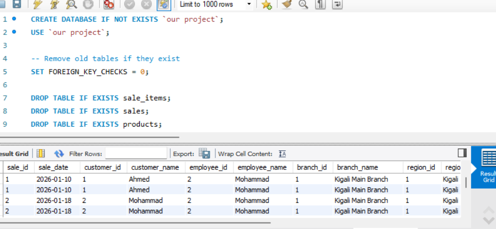
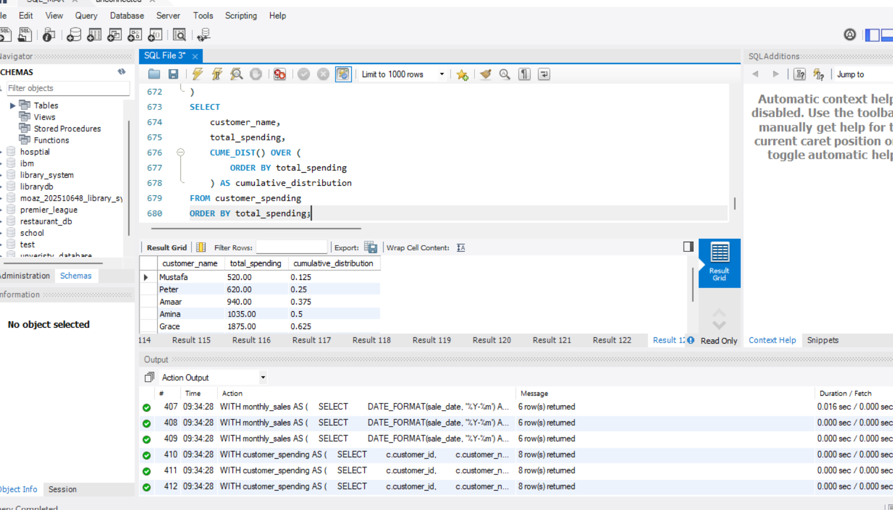
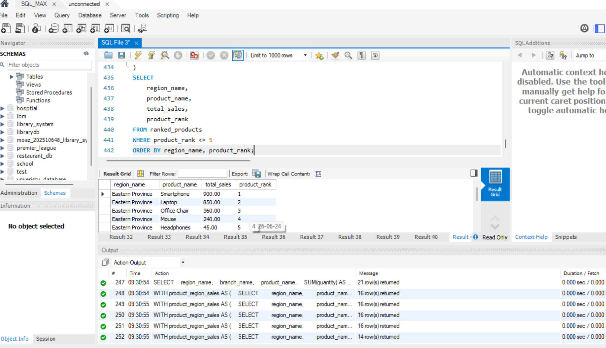
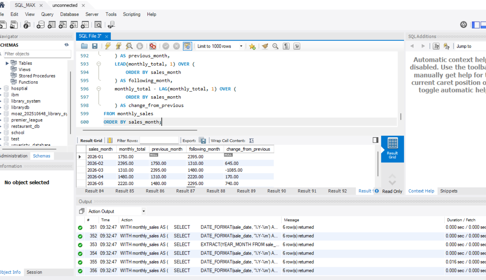
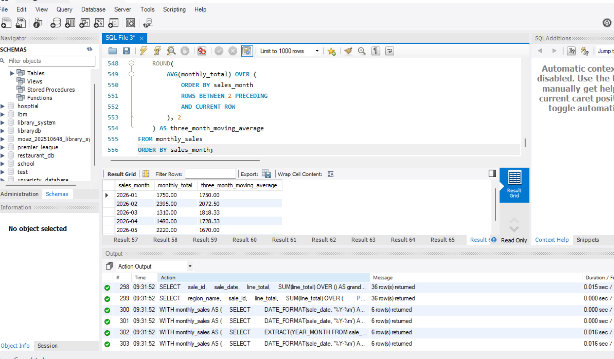
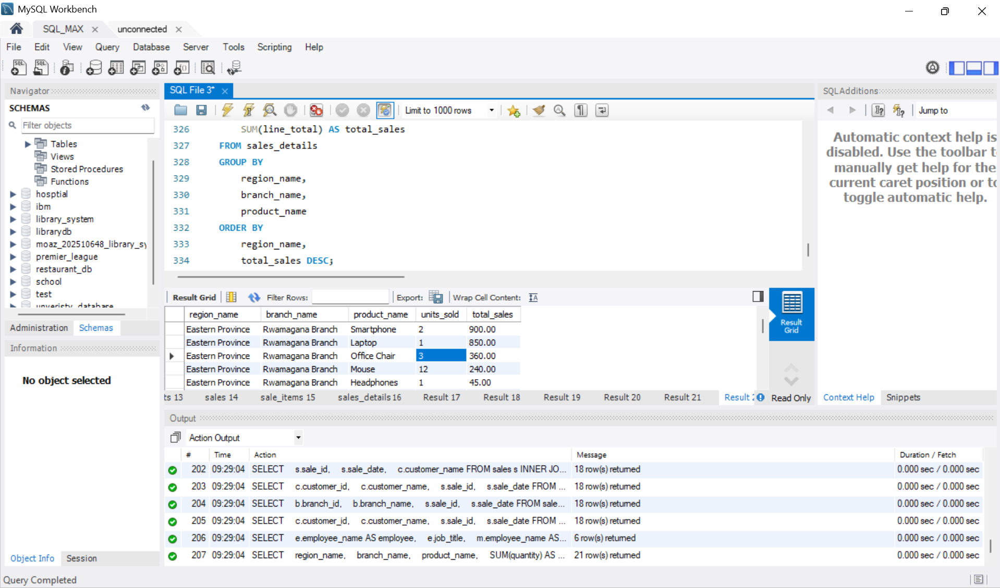
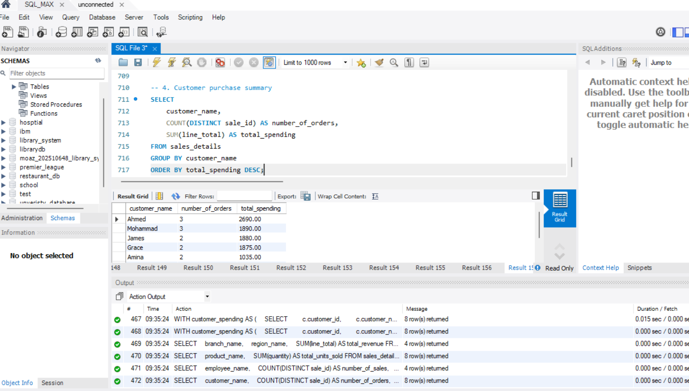

# Retail Sales Management System

**Database Management Systems – Group Project**

| | |
|---|---|
| **Institution** | Kigali Independent University (ULK) |
| **Programme** | Data Science – Year 2 |
| **Course** | Database Management Systems |
| **Instructor** | Eric Maniraguha |
| **Database Name** | `our project` |
| **DBMS** | MySQL 8.0+ |
| **Project Topic** | SQL JOINs and Window Functions |

---

## 1. Group Members

| No. | Registration Number | Student Name |
|---|---|---|
| 1 | 202510734 | Mustafa Omer |
| 2 | 202510648 | Moaz Mohammad |
| 3 | 202510853 | Abdulrahman Suliman |
| 4 | 202513707 | Nabeel Suliman |
| 5 | 202512952 | Maysara Dafaallh |

---

## 2. Project Overview

The Retail Sales Management System is a database project designed to manage and analyse sales activities in a retail business.

The system stores information about regions, branches, employees, customers, products, and sales transactions.

This project demonstrates the use of SQL JOIN operations and Window Functions to retrieve, connect, and analyse data from multiple database tables.

The system helps management understand sales performance, identify top-selling products, compare branches, evaluate employees, and analyse customer spending.

## 3. Problem Statement

Retail businesses manage large amounts of information about customers, products, employees, branches, and sales.

When this information is stored separately, it becomes difficult to analyse business performance and make accurate decisions.

This project provides a relational database solution that connects business information and allows users to perform advanced SQL queries for sales analysis and reporting.

## 4. Project Objectives

1. Design a relational database for a retail business.
2. Create related tables using Primary Keys and Foreign Keys.
3. Insert sample data into the database.
4. Apply different SQL JOIN operations.
5. Implement SQL Window Functions.
6. Analyse sales performance across regions and branches.
7. Identify top-selling products and valuable customers.
8. Support business decisions using SQL queries.

## 5. Business Scenario

The system represents a retail company operating in different regions and branches.

Each region contains several branches. Each branch has employees who serve customers and process sales transactions.

Customers purchase different products, and each sale can contain multiple products.

The database connects all these activities to provide useful business reports and sales analysis.

---

## 6. Database Design

The database contains seven main tables.

### 6.1 Regions
Stores information about the regions where the company operates.
- `region_id` – Primary Key
- `region_name` – Region name

### 6.2 Branches
Stores information about company branches.
- `branch_id` – Primary Key
- `branch_name` – Branch name
- `region_id` – Foreign Key
- `city` – Branch location

### 6.3 Employees
Stores employee information.
- `employee_id` – Primary Key
- `employee_name` – Employee name
- `job_title` – Job position
- `branch_id` – Foreign Key
- `manager_id` – Self-referencing Foreign Key

### 6.4 Customers
Stores customer information.
- `customer_id` – Primary Key
- `customer_name` – Customer name
- `email` – Customer email
- `city` – Customer location
- `registration_date` – Registration date

### 6.5 Products
Stores information about available products.
- `product_id` – Primary Key
- `product_name` – Product name
- `category` – Product category
- `unit_price` – Product price

### 6.6 Sales
Stores sales transaction information.
- `sale_id` – Primary Key
- `customer_id` – Foreign Key
- `employee_id` – Foreign Key
- `branch_id` – Foreign Key
- `sale_date` – Transaction date

### 6.7 Sale_Items
Stores the products included in each sales transaction.
- `sale_item_id` – Primary Key
- `sale_id` – Foreign Key
- `product_id` – Foreign Key
- `quantity` – Quantity sold
- `unit_price` – Price per unit

---

## 7. Entity Relationship Diagram (ERD)

The ERD illustrates the database tables and their relationships.


Relationships:
- One Region has many Branches.
- One Branch has many Employees.
- One Employee can manage other Employees.
- One Customer can make many Sales.
- One Employee can process many Sales.
- One Branch can record many Sales.
- One Sale can contain many Sale_Items.
- One Product can appear in many Sale_Items.

The `Sale_Items` table connects `Sales` and `Products`.

## 8. Technologies Used

- **MySQL 8.0+** – Database management system
- **SQL** – Database creation, data insertion, and analysis
- **MySQL Workbench** – SQL query execution and database management
- **GitHub** – Project storage and documentation
- **ERD** – Database structure and relationship visualization

---

## 9. Database Implementation

The database is created using:

```sql
CREATE DATABASE IF NOT EXISTS `our project`;
USE `our project`;
```

The SQL implementation includes:
- Database creation
- Table creation
- Primary Key constraints
- Foreign Key constraints
- Sample data insertion
- SQL JOIN queries
- Window Function queries
- Business analysis queries

**Screenshot – Database setup (CREATE DATABASE, DROP TABLE, and the sales join result):**


---

## 10. SQL JOIN Operations

JOIN operations are used to retrieve related information from multiple tables.

### 10.1 INNER JOIN
Returns records that have matching values in both tables.

*Example: Display sales together with customer information.*



### 10.2 LEFT JOIN
Returns all records from the left table and matching records from the right table.

*Example: Display all customers, including customers who have not made purchases.*

### 10.3 RIGHT JOIN
Returns all records from the right table and matching records from the left table.

*Example: Display all branches, including branches without sales.*

### 10.4 FULL OUTER JOIN
Returns matching and non-matching records from both tables.

> **MySQL Note:** MySQL does not directly support `FULL OUTER JOIN`. It can be simulated using `LEFT JOIN` and `RIGHT JOIN` combined with `UNION ALL`, filtering out duplicate matches.

### 10.5 SELF JOIN
Joins a table to itself.

*Example: Display employees together with their managers using the Employees table.*

---

## 11. SQL Window Functions

Window Functions perform calculations across related rows without combining all rows into one result.

### 11.1 Ranking Functions
- `ROW_NUMBER()` – Assigns a unique number to each row.
- `RANK()` – Assigns ranks and skips numbers after ties.
- `DENSE_RANK()` – Assigns ranks without skipping numbers.
- `PERCENT_RANK()` – Calculates the relative rank of a row.

### 11.2 Aggregate Window Functions
- `SUM() OVER()` – Calculates a total.
- `AVG() OVER()` – Calculates an average.
- `MIN() OVER()` – Finds the minimum value.
- `MAX() OVER()` – Finds the maximum value.
- `COUNT() OVER()` – Counts records.

### 11.3 Window Clauses
- `PARTITION BY` – Divides rows into groups.
- `ORDER BY` – Defines the order of rows.
- `ROWS BETWEEN` – Defines a window using physical rows.
- `RANGE BETWEEN` – Defines a window using ordering values and peer rows.

### 11.4 Navigation Functions
- `LAG()` – Retrieves a value from a previous row.
- `LEAD()` – Retrieves a value from a following row.

### 11.5 Distribution Functions
- `NTILE(4)` – Divides rows into four groups.
- `CUME_DIST()` – Calculates cumulative distribution.

**Screenshot – `CUME_DIST()` on customer spending:**



---

## 12. Five Main Success Criteria

### 12.1 Top Five Products in Each Region
Uses `RANK()` to identify the five highest-ranked products in each region based on sales.

**Business Benefit:** Helps identify popular products in different regions.



### 12.2 Cumulative Monthly Sales
Uses `SUM() OVER()` to calculate cumulative monthly sales.

**Business Benefit:** Helps management monitor sales growth over time.

### 12.3 Monthly Sales Comparison
Uses `LAG()` and `LEAD()` to compare sales with previous and following months.

**Business Benefit:** Helps identify sales increases and decreases.



### 12.4 Customer Segmentation
Uses `NTILE(4)` to divide customers into four groups according to their spending.

**Business Benefit:** Helps identify customer groups for marketing strategies.


### 12.5 Three-Month Moving Average
Uses `AVG() OVER()` to calculate the moving average of sales over three months.

**Business Benefit:** Helps identify general sales trends and reduce the effect of short-term fluctuations.



---

## 13. Practical Business Analysis

### Problem 1: Best-Selling Products
Identifies the products with the highest sales quantities and revenue.

**Business Value:** Helps management make better inventory decisions.



### Problem 2: Branch Revenue Analysis
Calculates and compares revenue generated by different branches.

**Business Value:** Helps management evaluate branch performance.

### Problem 3: Employee Sales Performance
Analyses sales transactions and revenue generated by each employee.

**Business Value:** Helps management evaluate employee performance.

### Additional Analysis: Customer Spending
Identifies customers according to their total spending.

**Business Value:** Helps the company understand customer behaviour and improve customer retention.



---

## 14. Expected Results

After executing the SQL scripts, the system should demonstrate:

- Successful creation of seven related database tables
- Correct Primary Key and Foreign Key relationships
- Successful execution of different JOIN operations
- Product ranking by region
- Cumulative monthly sales calculations
- Monthly sales comparisons
- Customer segmentation into four groups
- Three-month moving averages
- Business reports for branches, employees, products, and customers

The actual results depend on the sample data inserted into the database.

## 15. How to Run the Project

1. Install MySQL 8.0 or later.
2. Open MySQL Workbench.
3. Connect to your MySQL server.
4. Open the project's SQL script.
5. Execute the script in the correct order.
6. The database and tables will be created.
7. Sample data will be inserted.
8. Execute the JOIN and Window Function queries.
9. Review the results in MySQL Workbench.

> **Important:** Some scripts may contain `DROP TABLE` statements to recreate tables. Back up important data before executing them again.

## 16. Project Structure

```
Retail-Sales-Management-System/
│
├── README.md
├── ERD.png
│
├── SQL/
│   ├── create_database_and_tables.sql
│   ├── insert_sample_data.sql
│   ├── joins_queries.sql
│   ├── window_functions.sql
│   └── business_analysis.sql
│
└── Screenshots/
    ├── table_creation/
    ├── joins/
    ├── window_functions/
    └── business_analysis/
```
## 17. Limitations and Future Improvements

The current project focuses on core retail sales operations using a relational database and SQL queries. Future improvements could include real-time sales tracking, inventory management, automated report generation, and interactive dashboards to provide deeper business insights.


## 18. Conclusion

The Retail Sales Management System demonstrates how SQL and relational database concepts can be used to organise and analyse retail business information.

Through the implementation of JOIN operations and Window Functions, the project provides useful insights into sales performance, product ranking, customer spending, employee performance, and branch revenue.

The system shows how database technologies can support business analysis and improve management decision-making.

## 19. References

1. [MySQL 8.0 Reference Manual](https://dev.mysql.com/doc/refman/8.0/en/)
2. [MySQL JOIN Clause](https://dev.mysql.com/doc/refman/8.0/en/join.html)
3. [MySQL Window Functions](https://dev.mysql.com/doc/refman/8.0/en/window-functions.html)

---

**Project Title:** Retail Sales Management System  
**Course:** Database Management Systems  
**Instructor:** Eric Maniraguha  
**Institution:** Kigali Independent University _ULK
